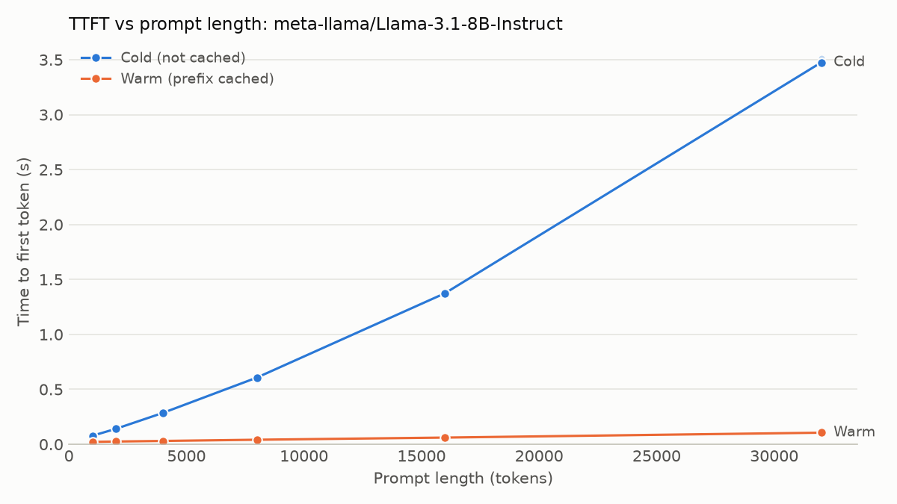
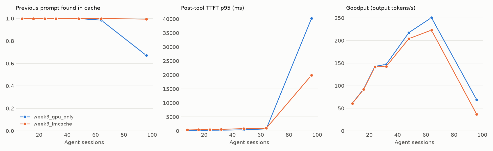

# project-Anton

A benchmark for **KV-cache offloading and prefetching for tool-calling AI agents**.

An AI agent pauses while its tools run. During that pause the inference server can evict the
agent's KV cache (the model's saved work for each token it has read), so the next step has to
recompute a long context. This project measures how well moving that cache to cheaper storage and
prefetching it back works, and how fast the storage must be for that to pay off.

## Status

**Weeks 1-3 have real measurements on an A100.** Results so far don't show offload winning on its own:
LMCache removes cache misses, but in the Week 3 sweep it lowers goodput. Later experiments are testing
whether that changes when cache capacity, rather than GPU compute, is the limit.

## Week 1 result: what the prefix cache saves

Llama-3.1-8B (bf16) on one A100 80GB, vLLM 0.33.0, requests sent one at a time, 32 output tokens.
Run [`20261105T074136Z_a100_llama31_8b`](results/20261105T074136Z_a100_llama31_8b), 5 repeats per
cell. All 62 requests passed the validity checks.



| Prompt tokens | Cold TTFT (ms) | Warm TTFT (ms) | Cold / warm | Avg prefill (tokens/s) | KV size (GB) | Break-even storage (GB/s) |
|---:|---:|---:|---:|---:|---:|---:|
| 1,000 | 77.7 | 22.0 | 3.5x | 12,866 | 0.13 | 2.35 |
| 2,000 | 140.8 | 25.3 | 5.6x | 14,202 | 0.26 | 2.27 |
| 4,000 | 285.8 | 30.5 | 9.4x | 13,996 | 0.52 | 2.05 |
| 8,000 | 607.4 | 41.5 | 14.6x | 13,170 | 1.05 | 1.85 |
| 16,000 | 1,374.9 | 61.1 | 22.5x | 11,637 | 2.10 | 1.60 |
| 32,000 | 3,475.0 | 105.7 | 32.9x | 9,209 | 4.19 | 1.24 |

**What was measured**
- Cached prompts reach the first token up to 33x faster, and the gap widens with length.
- Prefill cost per token rises with length, so no single prefill rate describes this GPU. A straight
  line fits with r-squared 0.988 but implies a negative startup time, so it's wrong in spite of that.
- TPOT also rises with context, from 10.8 ms at 1k to 12.2 ms at 32k.
- Cross-check at 2,000 tokens against `vllm bench serve` (20 requests): TTFT 140.8 vs 148.1 ms,
  and TPOT 10.87 vs 10.93 ms.

**What this doesn't show**
- Break-even is calculated from these measurements: KV size / (cold TTFT - warm TTFT). No KV cache
  has been moved to storage yet. It ignores storage latency and transfer overhead, so real storage
  must be faster than these numbers.
- Why the cost per token rises hasn't been tested. One possible cause is that each new token attends
  to a longer context, but that is only a hypothesis so far.
- This is one session on one shared GPU with 5 repeats per cell, one request at a time, using random
  token IDs. It says nothing about load, and it's a smaller model than Llama-3.3-70B.

## Week 2 check: agent replay on a real server

Same A100 and model, using the [plan's numbers](configs/traces/agent_plan_assumptions.yaml), run before
calibration showed they were too large. **So this shows the harness works and doesn't describe real
agents.**
All 211 requests were valid, and every request met the TTFT under 2 s and TPOT under 100 ms targets.

| Sessions | Requests | Peak concurrent | Output tokens/s | Post-tool TTFT p50 (ms) | Post-tool TTFT p95 (ms) | TPOT p50 (ms) | Previous prompt cached | Final contexts vs KV capacity |
|---:|---:|---:|---:|---:|---:|---:|---:|---:|
| 1 | 15 | 1 | 20.0 | 247.3 | not enough samples | 12.33 | 99.94% | 7% |
| 2 | 27 | 2 | 26.0 | 228.0 | 421.1 | 11.93 | 99.94% | 11% |
| 4 | 51 | 3 | 49.1 | 259.0 | 437.5 | 12.34 | 99.93% | 23% |
| 8 | 118 | 4 | 68.1 | 263.3 | 448.4 | 13.30 | 99.94% | 50% |

- **No cliff yet, as expected.** Each turn still found its previous prompt in the cache, and 8 sessions
  fill about half of the KV capacity.
- **Latency barely moved with load**, because at most 4 requests overlapped. These runs don't reach
  the server's limits, so the goodput numbers here equal throughput and say nothing about its capacity.
- **Peak `vllm:kv_cache_usage_perc` was only 13%.** It looks like it counts running requests only, so
  it isn't a measure of how full the cache is. "Previous prompt cached" is the better early signal.
- Each row is one short run. Sweep points shared one server, one after another.

## Week 3 result: the cliff, and what CPU offload does to it

Calibrated agents arriving at 1 per second, on the full 56 GiB GPU KV cache, with and without LMCache
0.5.6 offloading to CPU RAM. Goodput counts requests meeting TTFT under 2 s and TPOT under 100 ms.



| Sessions | Setup | Peak concurrent | Found in cache | Hit TTFT p50 (ms) | Hit TTFT p95 (ms) | Miss TTFT p50 (ms) | TPOT p50 (ms) | Met targets | Goodput (tokens/s) |
|---:|---|---:|---:|---:|---:|---:|---:|---:|---:|
| 32 | GPU only | 18 | 99.9% | 120 | 263 | no misses | 18.4 | 100% | 147 |
| 32 | LMCache | 20 | 99.9% | 183 | 562 | no misses | 20.7 | 100% | 143 |
| 48 | GPU only | 30 | 99.9% | 168 | 367 | no misses | 28.5 | 100% | 218 |
| 48 | LMCache | 31 | 99.9% | 276 | 796 | no misses | 33.8 | 100% | 204 |
| 64 | GPU only | 41 | 98.5% | 218 | 518 | 1,503 | 46.8 | 99.1% | 251 |
| 64 | LMCache (see below) | 45 | 99.9% | 322 | 954 | no misses | 45.1 | 98.7% | 223 |
| 96 | GPU only | 62 | 67.1% | 280 | 1,437 | 33,324 | 101.0 | 49.9% | 69 |
| 96 | LMCache | 68 | 99.4% | 927 | 19,896 | 1 miss | 122.1 | 37.0% | 37 |

**What was measured**
- **There's a cliff between 64 and 96 sessions.** Goodput falls 73%, and a turn that misses the cache
  waits about 33 s, far beyond the 3.5 s a 32k recompute takes alone, so misses queue behind each other.
- **LMCache really does restore caches.** Turns finding their cache go from 67% to 99.4%.
- **But LMCache costs goodput here.** It's lower at every load above 16 sessions, and half at 96
  sessions. Even with no eviction, its TTFT is about 40-60% higher.
- **The compute limit arrives too.** TPOT passes the 100 ms target at 96 sessions in both setups.
- My prediction that about 32 sessions would start the cliff was wrong. Sessions finish and leave, so
  total context overstates what has to stay live at once.

**What this doesn't show**
- Why LMCache adds this overhead hasn't been tested. Saving each chunk to CPU RAM is the likely cause.
- This is LMCache's default settings on one machine in one session, without tuning.
- A client bug ended some sessions early when the model generated certain Unicode characters. It's
  fixed now. Most points lost 0-2 requests, but LMCache at 64 sessions lost 11 sessions' remaining
  requests, sending 13% less load, so that row isn't a fair comparison.

## Week 5 check: NVMe-oF on a local VM

A RAM disk served over NVMe-oF with real Linux kernel drivers, in a Linux VM on a Mac, read with fio at
LMCache's 32 MiB chunk size. Results are in [`results/week5_mac_vm_lab`](results/week5_mac_vm_lab).

| Path | Read, 32 MiB chunks (GB/s) | Mean latency, 4 KiB at depth 1 (us) |
|---|---:|---:|
| RAM disk, no protocol | 32.5 | 0.9 |
| NVMe-oF over TCP | 6.4 | 8.6 |
| NVMe-oF over Soft-RoCE (emulated RDMA) | 1.7 | 46.7 |

**This shows the protocols run end to end, and roughly what the software path costs. It doesn't
measure a network.** Two VMs couldn't reach each other on this Mac's virtual network, so the target and
initiator share one VM and no packet crosses even a virtual NIC. Real networks would add latency and
limit bandwidth. Soft-RoCE is software emulation, so it says nothing about RDMA hardware, and it's only
slower than TCP here because it does in software what a real RDMA NIC does in hardware.

## Agent trace calibration

Measured from 20,008 real runs in
[`nebius/SWE-agent-trajectories`](https://huggingface.co/datasets/nebius/SWE-agent-trajectories)
(CC BY 4.0, 3 of 12 shards). Full numbers are in
[`swe_agent.json`](configs/traces/calibration/swe_agent.json).

| Measure | Plan assumed | Measured median (p90) |
|---|---:|---:|
| Shared system prefix | ~3,000 tokens | 1,119 |
| Steps per session | 10-40 | 17 (50) |
| Model response | 50-300 tokens | 78 (192) |
| Edit output, 37% of tools | 500-3,000 tokens | 410 (1,253) |
| Search output, 25% | 500-3,000 tokens | 54 (163) |
| Read output, 19% | 500-3,000 tokens | 1,101 (1,389) |
| Run output, 19% | 500-3,000 tokens | 85 (375) |
| Final context | 15k-40k tokens | 11,788 (30,337) |

**Does the trace reproduce real sessions?** Final context wasn't an input, so it's a fair check:

| Final context (tokens) | p10 | p50 | p75 | p90 |
|---|---:|---:|---:|---:|
| Real runs | 5,460 | 11,788 | 28,335 | 30,337 |
| Calibrated trace | 5,175 | 12,038 | 21,548 | 30,902 |
| Plan's numbers | 25,709 | 30,717 | 31,392 | 31,748 |

**Known gaps**
- **Tool pauses aren't calibrated.** This dataset has no timing. Of 8 others, 6 showed no per-tool
  timing fields in their first rows, 1 returned a server error, and 1 keeps traces in separate files
  that weren't opened. Pause times are still assumptions, and they matter for when offloading pays off.
- **Long sessions are too rare.** p75 is low by 24%, and 16% of simulated sessions end near the
  context limit, against 30% of real ones. Real long sessions tend to have large outputs throughout,
  but the trace draws each output independently.
- **Token counts are approximate.** They use a public Qwen tokenizer because Llama's is gated. On this
  text, Qwen and GPT-2 tokenizers differ by 36%, so the choice matters and should be rechecked.
- **One agent.** These are SWE-agent runs from Llama models on one benchmark-style task set, so
  they may not describe other agents. The run output may also be cut short by the agent itself.

**What it means for Week 3:** sessions average about 15k tokens, so about 32 of them should fill the
A100's 461,216-token KV cache. That's a prediction from arithmetic, and Week 3 will test it.

## What gets measured

| Metric | Meaning |
|---|---|
| TTFT | Time to first token: from sending the request to the first generated token |
| TPOT | Time per output token: average gap between tokens after the first |
| Prefill rate | Tokens per second the GPU can read: prompt length / cold TTFT, at each length |
| Break-even bandwidth | Storage speed at which loading a KV cache takes as long as recomputing it |

Week 1 sends each prompt twice: once uncached (cold), then again right away (warm). Prompts are
exact-length random token IDs, and pairs run in a seeded shuffle. A request only counts as valid
if the server confirms the expected token counts and cache behavior.

## Run it

Tests and lint, which need no GPU:

```bash
uv run pytest
```

```bash
uv run ruff check .
```

For real measurements, open [notebooks/week1_ttft.ipynb](notebooks/week1_ttft.ipynb) on Kaggle or
Colab. On any machine with vLLM installed, the same steps are:

```bash
uv run anton server start --config configs/servers/t4_qwen05b.yaml
```

```bash
uv run anton ttft run --server configs/servers/t4_qwen05b.yaml --sweep configs/sweeps/week1_t4_qwen05b.yaml --run-id my-run
```

```bash
uv run anton ttft analyze results/my-run
```

```bash
uv run anton server stop --config configs/servers/t4_qwen05b.yaml
```

Rerunning with the same `--run-id` continues a stopped run.

To replay a workload, or a sweep that skips points already finished:

```bash
uv run anton replay run --server configs/servers/a100_llama31_8b.yaml --trace configs/traces/agent.yaml --run-id my-replay
```

```bash
uv run anton replay sweep --server configs/servers/a100_llama31_8b.yaml --sweep configs/replay/week2_agent_load.yaml
```

## Layout

| Path | Contents |
|---|---|
| `src/project_anton/harness/` | Streaming client, sweep and replay runners, server control, system monitor, run logging |
| `src/project_anton/traces/` | Seeded agent, multi-turn and long-context workloads |
| `src/project_anton/analysis/` | KV size math, summaries, goodput, prefill fit, plots |
| `configs/` | Server, sweep and trace settings, plus trace calibration data |
| `scripts/` | Reruns the trace calibration |
| `notebooks/` | Kaggle and Colab entry points |
| `tests/` | Unit tests, plus a fake vLLM server on a real socket |
| `results/<run_id>/` | Summaries in git; `raw/` stays out of git |

## Prior work

This builds on existing ideas and doesn't claim to have invented them: CachedAttention (USENIX ATC
2024), Continuum (2025), vLLM PagedAttention, and LMCache. Agent traces are calibrated from Nebius's
SWE-agent trajectories dataset.
